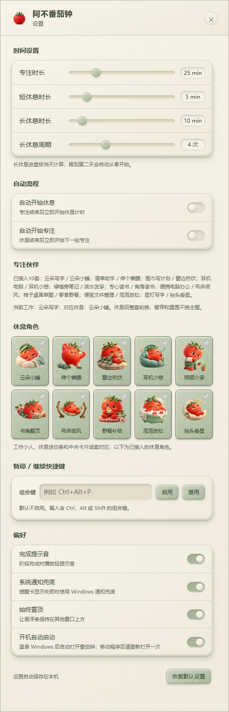

# 阿不番茄钟 · Abu Pomodoro

一个给 Windows 桌面用的毛毡风悬浮番茄钟：十套小伙伴，工作与休息成套陪伴。


[下载 Windows 版](https://github.com/xiaobu354-collab/abu-pomodoro/releases/latest) · [十套主题](#十套伙伴不止换一张图) · [使用说明](#开始使用) · [开发与构建](#开发与构建) · [许可说明](#代码与美术分开授权)

> **首次使用前请注意：默认开启“开机自动启动”。** 启动程序会尝试设置 Windows 登录后自动打开；不需要时请到设置 → 偏好中关闭。移动程序文件夹后请重新打开一次，以更新启动路径。当前发行包未进行代码签名，Windows 可能显示安全提示；请核对下载来源，不要为了运行未知文件而关闭系统安全保护。

## 版本说明

当前正式版本为 **1.0.38**，Electron 运行时为 **43.8.1**。本次累计优化跨日启动、休息卡片和撤销交互，十套主题图片素材保持不变。公开发行包与对应源码以 [1.0.38 发布说明](docs/release-notes-v1.0.38.md) 为准。

## 它能做什么

- 小巧悬浮条：平时看倒计时，移入鼠标才显示操作按钮。
- 十套毛毡风伙伴：工作小人、休息迷你条、中央提醒卡片一套对应；休息后整套轮换，暂停、继续与重置不换主题。
- 中央休息卡片：专注完成后，“休息 / 跳过 / 2 分钟后提醒”同排显示；休息中提供“暂停 / 跳过休息 / 收起”，收起后保留迷你条。
- 重置、跳过等阶段操作提供 **5 秒撤销窗口**；迷你条在“专注 / 休息”文字处显示撤销图标。这 5 秒内不切换四按钮，点击撤销或到期后恢复，避免鼠标靠近时按钮被切走。
- 跨日重新打开时，重置上一天的计时会话与今日计数，保留个人设置和主题。
- 可调专注/休息时长、自动流程、提示音、通知兜底、置顶和暂停快捷键；设置与会话状态保存在本机。

## 十套伙伴，不止换一张图


云朵、清单、围巾、耳机、绿植、读书、微风、野餐、泡泡、星光。图鉴展示实际应用界面，没有用概念图代替功能。

## 开始使用

1. 从 [Releases](https://github.com/xiaobu354-collab/abu-pomodoro/releases/latest) 下载 `1.0.38` 的 Windows x64 压缩包，完整解压到固定文件夹；不要只取出里面的 `.exe`。
2. 打开 `MintPomodoro-CloudTrial.exe`（保留的兼容文件名，界面名称为阿不番茄钟）。鼠标移入悬浮条，点击播放按钮开始专注；同一按钮可暂停/继续。
3. 拖动小人区域移动悬浮条；通过齿轮打开设置。重置和跳过前留意当前阶段，误操作后在 5 秒内点击“撤销”。
4. 专注结束后，由提醒卡片开始休息；休息结束后再开始下一轮。默认不自动开始下一阶段，可在设置里分别开启。
5. 右键悬浮条或系统托盘图标可打开菜单。隐藏到托盘不等于退出，彻底关闭请使用菜单中的“退出”。

升级前先从菜单退出旧版，再解压并打开新版。设置文件位于 `%APPDATA%\MintPomodoro-CloudPairedTrial\preferences.json`；保留该目录即可沿用设置，建议升级前备份此文件。若更换程序文件夹，首次启动后请检查开机启动设置。


按钮从左至右：开始/暂停、重置、跳过、设置。截图处于运行中，因此首个按钮显示暂停。

### 休息时，换个姿势


中央卡片和迷你条使用同套休息小人。休息时可以暂停、跳过休息或收起；跳过后的状态和撤销提示不会挤动卡片主体。


### 默认节奏与设置

| 项目 | 默认值 |
| --- | --- |
| 专注 / 短休息 / 长休息 | 25 / 5 / 10 分钟 |
| 长休息周期 | 每 4 次专注；进度按当天计算，跨天归零 |
| 自动开始休息 / 自动开始专注 | 都关闭 |
| 开机自动启动 | **开启，可在设置中关闭** |
| 提示音 / 通知兜底 / 始终置顶 | 开启 |
| 暂停/继续快捷键 | 默认禁用，可设置组合键 |



设置图由真实设置页面在隔离环境中以默认状态渲染，未操作实际 Windows 启动项；为完整展示内容，截图高度大于日常设置窗口，日常窗口可滚动查看。

## 运行范围与边界

- 当前提供 **1.0.38 正式版本与对应源码**，不包含早期半成品和旧版开发历史。
- 目前只在 Windows 上验证；macOS、Linux 未验证，不提供可用性承诺。
- 设置和会话状态保存在本机，不需要注册账号。这里不作“绝不联网”“100% 安全”或“不会丢失数据”的保证；开发安装依赖、访问下载页等操作会使用网络。
- 开机启动的程序逻辑可检查与测试，但真实重启、重新登录 Windows 后的启动效果尚未完成实机验证。受系统权限、安全策略及程序移动影响，设置可能失败；失败时以界面提示与 Windows 启动项实际状态为准。
- 本工具用于提醒和节奏管理，不保证提高工作效率，也不替代健康建议。代码与素材均按各自许可提供，无额外质量担保。

## 开发与构建

需要 Node.js、npm 和 Windows 开发环境。以锁文件安装依赖，再启动十套主题版本：

```powershell
npm ci
npm start
npm test
npm run build:portable
npm run verify:package
```

`npm start` 使用 `electron . --paired-theme-trial`，这是该版本的成套主题启动入口。便携构建输出到 `dist/AbuPomodoro-1.0.38-win32-x64`；应完整分发该目录及随附许可，不要只复制可执行文件。具体打包、校验规则见 `scripts/`。

文档图由真实界面截图排版而成，排版源见 [showcase.html](docs/showcase.html)。已有 `docs/images/` 原始截图时，可使用 `npx --no-install electron scripts/capture-docs.cjs` 重建首图、图鉴与设置图；该脚本只在临时用户目录和隐藏窗口中渲染，不调用真实程序的启动项逻辑。

## 代码与美术分开授权

- **源码、脚本、HTML、CSS、JSON 等技术文件：** [MIT](LICENSE)，包括 `assets/` 中的技术文件。
- **小人、图标、纹理等美术图片和含美术的文档截图：** [CC BY-NC 4.0](ASSET-LICENSE.md)，需署名，限非商业用途；商业使用需另行许可。
- **Electron、Chromium、Node.js 等第三方组件：** 保留各自原许可证，详见 [第三方说明](THIRD_PARTY_NOTICES.md)。

代码可商用不代表附带美术也可商用。部分美术使用 AI 辅助制作，不宣称独占版权或所有来源均已完整核实；授权仅覆盖许可人有权授权的内容。

作者：阿不 / A Bu。问题或建议请通过仓库 Issues 提交，并注明版本、Windows 版本和复现步骤；截图前请遮盖个人信息。
